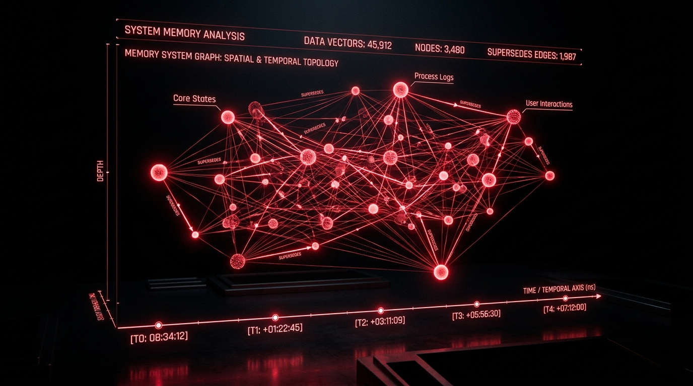

<p align="center">
  
</p>

<h1 align="center">Lethe</h1>

<p align="center">
  A temporal, self-correcting agent memory system on <a href="https://github.com/hydra-db/hydradb">HydraDB</a>.
  <br />
  Built for Hack Hydra — Track 3: Agent Memory.
</p>

<p align="center">
  
  
  
  
  
</p>

<p align="center">
  <a href="https://lethe-hydradb.vercel.app"><strong>Live landing page →</strong></a>
</p>

---

## The problem

mem0/Zep-style agent memory stores facts as embeddings and retrieves by
cosine similarity. That can't tell a fresh fact from a contradicted one —
"I live in London" and "I live in Tokyo" are both highly similar to the
question "where do I live?", and a similarity search has no principled way
to prefer the current one. The naive baseline in this repo (`src/baseline/`)
reproduces exactly that failure, measurably, below.

## The fix

Facts are graph nodes. When a new fact contradicts an existing one about the
same entity+attribute, Lethe writes an explicit `SUPERSEDES` edge. Answering
"what do we know about X as of time T" is then a real graph query — filter
facts written by T, walk `SUPERSEDES` edges to find the one nothing
qualifying points at — not a similarity guess. If no fact ever existed,
`/recall` returns an explicit abstention (`{answer: null, reason:
"no_fact_stated"}`) backed by an actual non-existence check, not a guessed
"I don't know."

> **The invariant that must never break:** a `/recall` response never
> returns a superseded fact, and abstains rather than guesses when nothing
> is valid. See [`CLAUDE.md`](CLAUDE.md) and [`test/recall.test.ts`](test/recall.test.ts).

## Results

Measured by scoring Lethe's extracted-and-superseded answer against the
correct answer at two points in time — before an update fact exists, and
after — versus the naive cosine-similarity baseline on the same data.

| Benchmark | Update pairs (N) | Lethe — before update | Lethe — after update (the invariant) | Naive baseline |
|---|---|---|---|---|
| [LongMemEval](https://github.com/xiaowu0162/LongMemEval) (oracle, full 78-instance set) | 181 | 92% (166/181) | **91% (164/181)** | 1% (2/181) |
| [BEAM](https://github.com/mohammadtavakoli78/BEAM) (100K tier, all 20 chats) | 155 | 91% (141/155) | **100% (155/155)** | 1% (2/155) |

Reproduce these with `pnpm eval:longmemeval` / `pnpm eval:beam` — see
[Optional: LLM-powered features](#optional-llm-powered-features) below.

<details>
<summary>Why the "before update" numbers aren't 100%, and why an earlier <em>misleadingly clean</em> 100% wasn't more correct</summary>

The "before" misses are not a `/recall` correctness bug — traced directly
against live `/recall` and `/chain` output, some (entity, attribute) pairs
are multiple simultaneously-true facts sharing one attribute slug (e.g. two
different, non-contradicting shopping preferences from the same session),
correctly left unsuperseded by the semantic classifier, which the eval
script's linear-chain assumption doesn't account for. An earlier run showed
a misleadingly clean 100% here — that was itself an artifact of a
then-flakier classifier silently falling back more often, not a
more-correct result. See [`docs/LIMITATIONS.md`](docs/LIMITATIONS.md) for
the full investigation.

</details>

## How HydraDB is used (judged criterion: "Best Use of HydraDB")

- **Pinned per-query snapshot consistency.** Every HydraDB query — including
  every `/recall` lookup — runs against one consistent snapshot, so a
  concurrent write mid-query can't produce a torn read. This is a real
  property Lethe depends on for correctness. **It is not, however, the
  mechanism behind `/recall`'s `as_of` time-travel** — HydraDB's HTTP API
  explicitly rejects a client-supplied `read_epoch` ("`read_epoch is not a
  storage snapshot selector; use bookmark for causal reads`"). Point-in-time
  correctness here is ordinary Cypher property filtering
  (`Fact.written_at <= as_of`) plus `SUPERSEDES`-edge walking. See
  `docs/LIMITATIONS.md` for the full, honest explanation — we'd rather state
  this plainly than overclaim to judges who know the product.
- **`algo.SPpaths`**, HydraDB's native bounded shortest-path procedure,
  powers `GET /connect?from=A&to=B` — cross-entity graph traversal without
  app-side BFS.
- **`algo.SSpaths`** powers `GET /chain` — walking a `SUPERSEDES` chain as a
  native bounded traversal for the frontend's timeline visualization,
  instead of app-side recursive queries.
- **NDJSON streaming** (`Accept: application/x-ndjson`) on `GET /recall` —
  a real HydraDB HTTP feature, used so results can be piped into an agent
  loop instead of waiting for a full response.

## Architecture

```
(:Entity {name, kind})
(:Fact {id, content, written_at, session_id, attribute, idempotency_key})
(:Session {id, started_at})

(:Session)-[:STATES]->(:Fact)
(:Fact)-[:ABOUT]->(:Entity)
(:Fact)-[:SUPERSEDES {at}]->(:Fact)   // new fact -> older fact it invalidates
```

Backend: Node.js + TypeScript + Express, talking to HydraDB over its plain
HTTP/JSON query API (no Bolt driver — see `src/db/hydraClient.ts`).
Frontend: a single static page, two panels (`public/`), served directly by
the Express app. `web/` is a separate, more polished React 19 + Vite +
Tailwind marketing/landing page (with an illustrative "Temporal Recall
Playground" walkthrough of the four demo scenarios — not wired to the live
`/recall` API, clearly labeled as such) — see `web/README.md`:
```bash
cd web && pnpm install && pnpm dev      # or `pnpm build` for a static build
```

## Running locally

Prerequisites: Node 20+, pnpm, Docker.

```bash
pnpm install

# 1. Start HydraDB (creates .hydradb-data/, waits for readiness)
bash scripts/hydradb-up.sh

# 2. Start the app
cp .env.example .env
pnpm dev

# 3. Seed the demo's LongMemEval-derived contradiction facts
pnpm seed

# 4. Open the frontend
#    http://127.0.0.1:3000

# 5. Run the baseline-vs-Lethe accuracy comparison
pnpm baseline:eval
```

Optional: for semantic conflict detection and automated LongMemEval
extraction (see [Optional: LLM-powered features](#optional-llm-powered-features)
below), set exactly one of `ANTHROPIC_API_KEY`, `OPENAI_API_KEY`, or
`GEMINI_API_KEY` in `.env`. With none set, everything above works
identically — conflict detection falls back to exact-string matching
automatically.

On native Windows with Docker Desktop and no bash (no WSL, no Git Bash),
replace step 1 with:
```powershell
powershell -ExecutionPolicy Bypass -File scripts/hydradb-up.ps1
```

## Running tests

```bash
bash scripts/hydradb-up.sh   # or scripts/hydradb-up.ps1 on native Windows
pnpm test
```

`test/recall.test.ts` is the one required correctness guard: it seeds two
conflicting facts at different timestamps and asserts `/recall`'s
supersession-walk returns the right one on either side of the update, and
abstains before either fact existed. It talks to a real running HydraDB, not
a mock — the property it guards is a graph-shape property.

## Demo dataset

`data/longmemeval/subset.json` is a 4-instance real subset of the
[LongMemEval](https://github.com/xiaowu0162/LongMemEval) oracle dataset
(3 `knowledge-update` cases + their paired abstention case). Facts are
hand-extracted from the evidence turns into entity/attribute/content
triples in `src/demoFacts.ts` — deliberate, so the frontend has clean,
natural-language sentences to display.

## Optional: LLM-powered features

Both require one of `ANTHROPIC_API_KEY` / `OPENAI_API_KEY` /
`GEMINI_API_KEY` (see `src/lib/llm/`); without one, both fall back
automatically rather than failing.

**Semantic conflict detection.** By default, a new fact supersedes a prior
one about the same entity+attribute only if their content strings differ.
That can't tell a paraphrase ("5 ounces" vs. "five ounces") from a genuine
update — with a key set, `src/lib/conflictClassifier.ts` asks a small LLM
to classify `same` / `contradicts` / `unrelated` instead, with the
exact-string check as a mandatory fallback on any failure. See
`docs/LIMITATIONS.md` for the honest reliability caveats.

**Automated LongMemEval evaluation**, on real subsets larger than the
hand-curated demo — a 23-instance starter set
(`data/longmemeval/eval_subset.json`) and the full 78-instance oracle set
(`data/longmemeval/eval_subset_full.json`: ALL 72 knowledge-update
instances in the oracle dataset + all 6 paired abstention instances, not a
sample):
```bash
pnpm ingest:longmemeval   # extracts + ingests real transcripts via the LLM
pnpm eval:longmemeval     # scores Lethe's supersession correctness, with N stated
# Or, against the full 78-instance set:
LONGMEMEVAL_DATA_PATH=data/longmemeval/eval_subset_full.json pnpm ingest:longmemeval
```
See [Results](#results) above for real numbers from this run.

**Also run against BEAM** ([mohammadtavakoli78/BEAM](https://github.com/mohammadtavakoli78/BEAM)),
a genuinely different long-term-memory benchmark — real multi-turn
conversations (not LongMemEval's), 10 scored memory-ability categories
including its own independent `knowledge_update`/`contradiction_resolution`/
`abstention` questions, chosen specifically to demonstrate the same
invariant on a dataset with no shared lineage to LongMemEval. Not bundled
in this repo (its smallest ("100K") tier alone is tens of MB of JSON per
chat across 20 chats) — clone it yourself and point `BEAM_DATA_ROOT` at it:
```bash
git clone --depth 1 https://github.com/mohammadtavakoli78/BEAM.git
BEAM_DATA_ROOT=/path/to/BEAM pnpm ingest:beam   # extracts + ingests all 20 "100K"-tier chats
pnpm eval:beam                                  # scores Lethe's supersession correctness
```
Run for real against all 20 chats in the "100K" tier (confirmed live:
~200k+ tokens/chat once parsed, not literally 100K — BEAM's own tier
label, not a token guarantee; Gemini, `gemini-3.1-flash-lite`): 970 facts
ingested across 20/20 chats, zero failed extraction batches. Same
methodology as the LongMemEval eval above (`scripts/eval-beam.ts`),
deliberately: comparing Lethe's extracted-and-superseded answer against
the extractor's own last-written content, not BEAM's hand-authored
`ideal_answer` rubrics (which would need a separate LLM-judge scoring pass
to compare against, an unverified error source in its own right — see
`docs/LIMITATIONS.md`).

## Docs

| Doc | What's in it |
|---|---|
| [`docs/API_NOTES.md`](docs/API_NOTES.md) | Measured HydraDB HTTP API behavior, and what's still unverified against a live node. |
| [`docs/LIMITATIONS.md`](docs/LIMITATIONS.md) | What's explicitly not handled, stated plainly. |
| [`docs/THREAT_MODEL.md`](docs/THREAT_MODEL.md) | Trust assumptions. |
| [`CLAUDE.md`](CLAUDE.md) | The invariant and engineering rules this repo was built against. |

## License

MIT — see [LICENSE](LICENSE).
